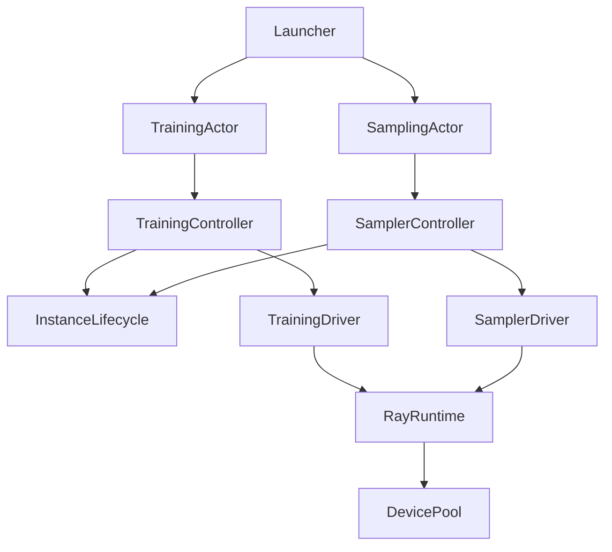

# Server responsibilities

The training and sampling pools share resource mechanisms, but own separate scheduling policies and records.

- `training/`: training catalog, handle ownership, placement policy, router and Ray actor composition.
- `model/`: training execution and backend/protocol adapters. `managed_runtime.py` implements worker-side admission and completion, not pool scheduling.
- `sampler/`: sampling policy, runtime execution and backend/protocol adapters. `actor.py` owns Ray composition; `controller.py` accepts an injected driver.
- `resources/`: shared device allocations, Ray/Serve deployment and confirmed shutdown, and background instance supervision. No training or sampling policy imports.
- `state/`: serializable records and persistence. Training records stay here so model execution need not import the training controller.
- `lifecycle/`: request submission, retrieval and Future/Envelope handling. This differs from the instance lifetime supervised in `resources/`.
- `config/`: configuration declarations and normalization. `telemetry/` consumes plain snapshots without importing controllers or their catalogs.

The three runtime modules have different boundaries: `server/runtime.py` initializes Twinkle and DeviceMesh; `resources/runtime.py` owns Ray/Serve effects; `sampler/runtime.py` tracks request execution inside a sampling instance.

Multi-LoRA execution registers every preallocated slot with the distributed reducer. DDP requires `find_unused_parameters=True` and `static_graph=False`; FSDP requires `reshard_after_forward=True` so adapter switches act on sharded parameters instead of retained views. Incompatible overrides fail during model initialization, before weights are loaded.

## Sampling ownership and state reconstruction

Stable sampling uses shared access; configuration and full-weight updates use exclusive access. Every participating instance is reserved before an update. Idle sweep checks the same reservations under the state lock. The lock order is configuration then state; startup is never awaited while holding the configuration lock.

Pool admission is bounded by `queue_timeout`. A complete control broadcast or full-weight update uses one `effective_execution_timeout`, including completion confirmation. An ambiguous result fences all participants. Cancellation alone never confirms device release; shutdown failure keeps the instance quarantined and counted against capacity.

Serve handle and resource inventory lookups run outside the controller event loop, so synchronous Ray metadata RPCs cannot prevent these deadlines from firing.

Only successful broadcasts update replay state. Superseded templates, adapter configurations (per owner/name), and full checkpoints are compacted after the last `apply_patch`. Arbitrary patches preserve order and form a compaction barrier: dependencies before a patch must remain available. LoRA weight caches are loaded per request and eviction is not replayed.

A client object rejects creation of an adapter name it already owns. Release it before creating a replacement; separate objects may use the same label.

## Tests

Unit tests follow the component they exercise. Reusable fake drivers and queues live in helper modules, not in imported `test_*.py` modules. Resource allocation probes live under `tests/server/integration/resources`, sampling probes under `tests/server/integration/sampler`, and training acceptance tools under `tests/server/integration/on_demand_training`.

Control fixtures demonstrate scheduling and release mechanisms, not real model execution. Hardware acceptance must separately record the tested commit, runtime import origins, real model operations, numerical checks and confirmed cleanup. The package DAG and lightweight import checks live in `tests/server/test_dependencies.py`.
