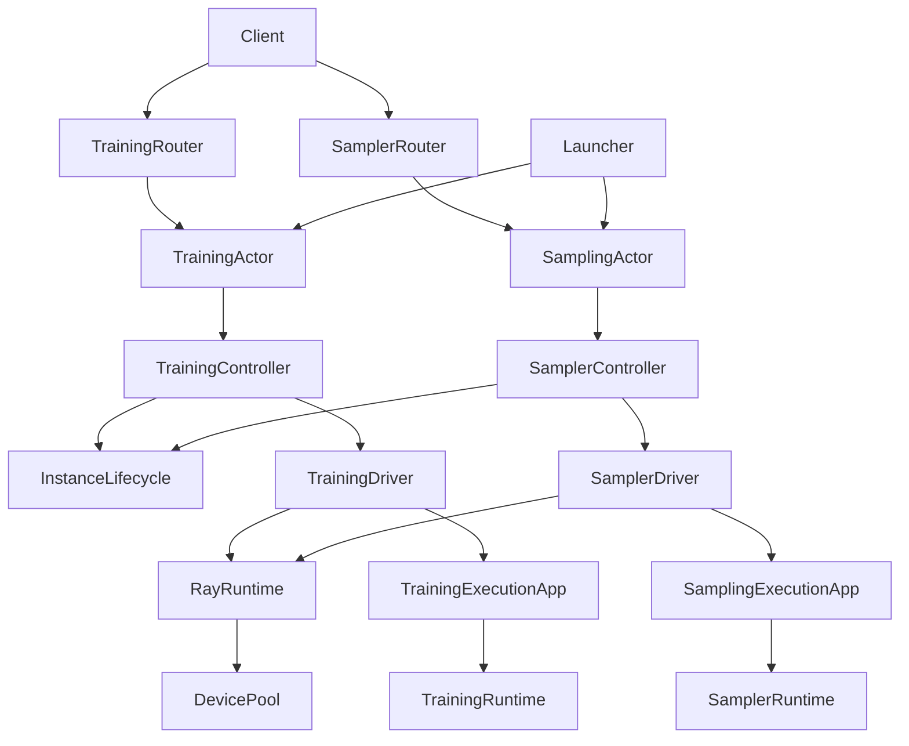

# Server responsibilities

The training and sampling pools share resource mechanisms, but own separate scheduling policies and records.

- `training/`: validated model lookup, handle ownership, placement policy, router and Ray actor composition. Its `execution/` subpackage implements backend/protocol adapters and worker-side admission/completion.
- `sampling/`: sampling placement, scaling, control broadcasts, router and Ray actor composition. Its `execution/` subpackage implements backend/protocol adapters and request completion tracking.
- In both domains, the controller makes business decisions, the driver performs domain-specific setup, the actor composes the controller with its driver, and the router handles public requests. Controllers accept injected drivers; importing a controller does not compose Ray actors.
- `resources/`: shared device allocations, Ray/Serve deployment and confirmed shutdown, and background instance supervision. No training or sampling policy imports.
- `state/`: serializable records and persistence. Training records stay here so model execution need not import the training controller.
- `lifecycle/`: request submission, retrieval and Future/Envelope handling. This differs from the instance lifetime supervised in `resources/`.
- `config/`: configuration declarations and normalization. `telemetry/` consumes plain snapshots without importing controllers or domain configuration.

The runtime modules have different boundaries: `server/runtime.py` initializes Twinkle and DeviceMesh; `resources/runtime.py` owns Ray/Serve effects; `sampling/execution/runtime.py` tracks sampling request execution, and `training/execution/runtime.py` executes controller-owned training handles.

Multi-LoRA execution registers every preallocated slot with the distributed reducer. DDP requires `find_unused_parameters=True` and `static_graph=False`; FSDP requires `reshard_after_forward=True` so adapter switches act on sharded parameters instead of retained views. Incompatible overrides fail during model initialization, before weights are loaded.

## Training configuration

The public YAML keeps `applications` with `import_path: model`, `args.train_mode`, `device_group`, and `device_mesh`. Each model application selects one training mode. To expose LoRA and full training for the same weights, use two applications with distinct names and route aliases. `config/training.py` owns the public arguments and resolves each application to one validated instance specification. Training idle expiration uses only `idle_timeout_s`. Optional top-level `resources` contains the shared allocation/startup/shutdown/monitor budgets, independent of training or sampling policy.

## Sampling ownership and state reconstruction

Stable sampling uses shared access; configuration and full-weight updates use exclusive access. Every participating instance is reserved before an update. Idle sweep checks the same reservations under the state lock. The lock order is configuration then state; startup is never awaited while holding the configuration lock.

Pool admission is bounded by `queue_timeout`. A complete control broadcast or full-weight update uses one `effective_execution_timeout`, including completion confirmation. An ambiguous result fences all participants. Cancellation alone never confirms device release; shutdown failure keeps the instance quarantined and counted against capacity.

Serve handle and resource inventory lookups run outside the controller event loop, so synchronous Ray metadata RPCs cannot prevent these deadlines from firing.
Placement-group creation remains tracked across cancellation; removal waits for the late result before certifying release.

Only successful broadcasts update replay state. Superseded templates, adapter configurations (per owner/name), and full checkpoints are compacted after the last `apply_patch`. Arbitrary patches preserve order and form a compaction barrier: dependencies before a patch must remain available. LoRA weight caches are loaded per request and eviction is not replayed.

A client object rejects creation of an adapter name it already owns. Release it before creating a replacement; separate objects may use the same label.

## Tests

Unit tests follow the component they exercise. Reusable fake drivers and queues live in helper modules, not in imported `test_*.py` modules. Resource allocation probes live under `tests/server/integration/resources`, sampling probes under `tests/server/integration/sampler`, and training acceptance tools under `tests/server/integration/on_demand_training`.

Control fixtures demonstrate scheduling and release mechanisms, not real model execution. Hardware acceptance must separately record the tested commit, runtime import origins, real model operations, numerical checks and confirmed cleanup. The package DAG and lightweight import checks live in `tests/server/test_dependencies.py`.

## Public training entrypoints

Clients still create and release training handles. A stable CPU router now owns those public paths:

| API | Public path | Behavior |
| --- | --- | --- |
| Twinkle | `twinkle/create` | Return service capabilities; no device allocation |
| Twinkle | `twinkle/add_adapter_to_model` | Allocate a handle and start an instance when needed |
| Twinkle | `twinkle/remove_adapter` | Release the handle; reclaim idle excess capacity |
| Tinker | `tinker/create_model` | Allocate a training handle |
| Tinker | `tinker/unload_model` | Release that handle |

Forward, backward, optimizer, save/load and retrieve paths remain available through the router. The SDK carries the returned `training_id` (Tinker calls it `model_id`); the router resolves its owning instance and epoch on every request. This replaces Serve multiplexing affinity: a handle stays with its owning instance, while clients may reach any CPU router replica. A worker rejects direct create/unload calls because it cannot allocate or retire controller-owned resources. No public lifecycle endpoint was removed.

## Ray infrastructure boundary

`infra/_ray/ResourceManager` builds worker groups and rank/device meshes; `RayHelper` exposes that process-local infrastructure. Pool drivers reuse `ResourceManager.from_allocation`, platform device discovery and the shared CPU sizing policy. `resources/DevicePool` owns dynamic placement groups and waits for confirmed removal; `resources/RayRuntime` owns Serve applications and late deployment cleanup. These async ownership/deadline rules do not belong in the process-global helper. Both pools use the same resource implementation.

State repositories compose the shared domain managers: `ServerState.models`, `.sessions`, `.futures`, and `.sampling_sessions`. `TrainingStore` owns training persistence and its retry ledger, while the record definitions remain independent of I/O. Constructing a store performs no storage operation.

## Component composition and execution contracts

There is no separate Catalog object: `TrainingConfig` already owns the validated model specifications and lookup by model/mode. The launcher normalizes YAML once and builds the two pools. `actor.py` is the Ray composition boundary; `controller.py` owns scheduling and mutable pool state; `driver.py` translates a scheduling decision into resource operations and domain-specific worker setup; `router.py` authenticates/routes public requests; `execution/app.py` builds the compute service and backend. Runtime objects execute requests inside that service. Neither router nor app allocates devices independently.

A common business Controller base would need switches for training handles, LoRA slots, exclusive full training, sampling load, and broadcast replay. Those policies have different invariants. Both controllers instead compose `InstanceLifecycle`; both drivers compose `RayRuntime`, which composes `DevicePool`. This is the reusable layer. Subdirectories keep each domain's scheduling and execution adjacent without mixing their responsibilities.

## Task queue flow

1. Parse/validate the request and check capabilities, quotas and owner admission before writing a Future.
2. Persist `pending` with an immutable deadline. Training work enters an adapter queue; sampling can reserve bounded concurrent execution.
3. Serial work records `queued` and wakes the round-robin worker. An atomic start claim changes an eligible Future to `running`; cancellation can win only before this claim.
4. Execution writes `completed` or `failed`. Queue timeout fails unstarted work; execution timeout fails the client Future. Late queued/running writes cannot regress a terminal record.
5. A client timeout, disconnect, or failed Future does not prove backend completion. The owning task/scope retains capacity and weight protection until actual completion; unknown completion fences the instance until confirmed shutdown.
6. Shutdown stops admission, fails queued work and joins owned execution. Unconfirmed worker/placement-group removal keeps the instance quarantined and counted against capacity.

`protocol/types` owns serializable request/response models and shared status enums. `task_queue/types.py` owns in-process coroutine factories, asyncio tasks and callbacks; these cannot be wire fields. `ExecutionScope` is passed explicitly from the internal request to admitted jobs, and waits for jobs registered by earlier jobs as well.

Business identity, retry metadata, resource ownership and completion witnesses must use explicit arguments or owned records. Use `ContextVar` only for genuinely ambient context such as logging/tracing where passing through every API adds no domain meaning. Every temporary context assignment must pair `set()` with `reset(token)` in `finally`; spawning tasks copies context and does not extend resource ownership.
